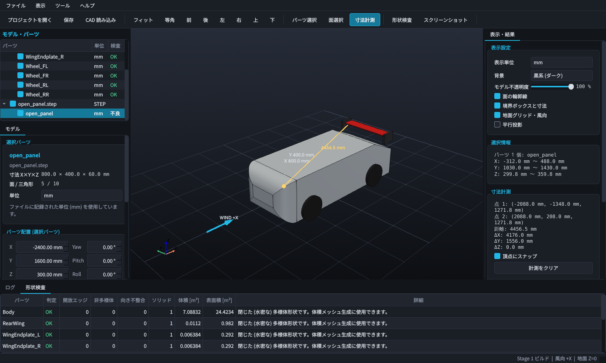

# LJM CFD — Claude Edition

Windows 11 用の自動車空力解析ワークベンチです。STEP などの車両・エアロパーツを読み込み、
仮想風洞で CFD 解析を行い、結果をスライダー操作で観察できるソフトウェアを段階的に開発しています。

既存の「LJM CFD Beta 0.6.2.3」とは **独立した新規プロジェクト** で、既存アプリのファイルは一切変更しません。

## 現在の実装状況

| Stage | 内容 | 状態 |
|---|---|---|
| 1 | GUI、3D 表示、STEP / IGES / STL 読み込み、モデル操作、形状検査 | **実装済み** |
| 2 | 仮想風洞、メッシュ生成、メッシュ品質チェック | 未実装 |
| 3 | OpenFOAM 連携、CFD 解析、荷重計算 | 未実装 |
| 4 | 速度・圧力・流線などの 3D 可視化 | 未実装 |
| 5 | 断面スライダー、流線開始位置スライダー、スモーク・粒子アニメーション | 未実装 |
| 6 | 結果出力、パフォーマンス改善、Windows 用パッケージング | 未実装（プロジェクト保存の基礎のみ Stage 1 に含む） |



*デモ車両を読み込み、寸法計測と形状検査を行った画面（Linux の仮想ディスプレイ上で実際に動作させて取得）*

> **このビルドでは CFD 計算は実行できません。** 空力結果の欄は常に「未計算」と表示されます。
> 全体設計は [docs/ARCHITECTURE.md](docs/ARCHITECTURE.md) を参照してください。

### 動作確認の状況（重要）

| 環境 | 状況 |
|---|---|
| Linux (Ubuntu 24.04) + Python 3.12 + 仮想ディスプレイ | 自動テスト 50 件すべて成功。実際にウィンドウを開いて操作する結合テストを含む |
| Windows 11 向け依存パッケージ | 同じバージョンの組み合わせが Windows x64 / Python 3.12 用バイナリとして **入手可能であることを確認**（インストールの実行は未確認） |
| **Windows 11 実機での起動・操作** | **未確認**。開発環境が Linux コンテナのため実行できていません |

Windows 固有の事項（`.bat` スクリプト、高 DPI でのクリック位置、日本語パス、`pythonw.exe` 起動）は
コード上で対策していますが、実機での確認が必要です。問題があれば `workspace\logs\ljmcfd.log` を添えてお知らせください。

---

## セットアップ（Windows 11）

### 1. 必要なもの

- Windows 11 64bit
- [Python 3.12 (64bit)](https://www.python.org/downloads/windows/) — インストール時に「py launcher」を有効にしてください
- OpenGL 3.2 以上に対応した GPU ドライバ
- WSL2 + Ubuntu 24.04 + OpenFOAM 14 は **Stage 3 から必要** です（現時点では不要。手順は Stage 3 で用意します）

### 2. 配置

このフォルダ一式を `C:\LJM_CFD_Claude` に置きます（`C:\LJM_CFD_Claude\run_ljm_cfd.bat` がある状態）。

```bat
git clone -b claude/inspiring-turing-aeayw4 https://github.com/EzpaNoLy0o/LunatechJapanModify.github.io.git C:\ljm_tmp
```

```bat
xcopy /E /I C:\ljm_tmp\LJM_CFD_Claude C:\LJM_CFD_Claude
```

> フォルダ名に日本語や空白を含めないでください。OpenCASCADE と OpenFOAM に ASCII パスを渡すためです
> （読み込む CAD ファイル自体は日本語パスにあっても構いません）。

### 3. 依存パッケージのインストール

```bat
C:\LJM_CFD_Claude\scripts\setup_windows.bat
```

`C:\LJM_CFD_Claude\.venv` に仮想環境を作り、PySide6・VTK・PyVista・OpenCASCADE (OCP)・Gmsh などを入れます（約 600 MB）。
テストも実行したい場合は `setup_windows.bat dev` とします。

### 4. 起動

```bat
C:\LJM_CFD_Claude\run_ljm_cfd.bat
```

起動しない・すぐ閉じる場合は、コンソール付きで起動するとエラーが見えます。

```bat
C:\LJM_CFD_Claude\run_ljm_cfd_debug.bat
```

### 5. デモモデル（任意）

手元に CAD が無くても試せるよう、Ahmed ボディと簡易車両アセンブリを生成できます。

```bat
C:\LJM_CFD_Claude\scripts\make_demo_models.bat
```

`C:\LJM_CFD_Claude\demo\` に `ahmed_body.step`、`demo_car.step`、`open_panel.step` が作られます。

---

## 使い方（Stage 1）

### 画面構成

| 位置 | 内容 |
|---|---|
| 左上 | モデル・パーツツリー（チェックで表示／非表示） |
| 左下 | 「モデル」タブ：選択パーツの寸法・単位・配置、車両全体の姿勢 |
| 中央 | 3D ビュー |
| 右 | 表示設定、選択情報、寸法計測、空力結果（未計算） |
| 下 | ログ、形状検査の結果一覧 |

各領域の境界はドラッグで幅・高さを変更でき、次回起動時に復元されます。

### 基本操作

1. **CAD 読み込み**: ツールバー「CAD 読み込み」（`Ctrl+I`）またはファイルをウィンドウへドラッグ＆ドロップ。
   STEP / STP / IGES / IGS / STL に対応。複数ファイルを読み込んで車両全体を構成できます。
2. **視点操作**: 左ドラッグ = 回転、中ドラッグ（または `Shift`+左ドラッグ）= 移動、ホイール = ズーム。
   `F` = フィット、`0`〜`6` = 等角／前／後／左／右／上／下。
3. **パーツ選択** (`Q`): 3D ビューまたはツリーでクリック。`Ctrl`+クリックで追加選択。
4. **面選択** (`W`): 面をクリックすると面積・平均法線・曲面種別を表示。
5. **寸法計測** (`E`): 2 点をクリック。距離と ΔX / ΔY / ΔZ を表示（頂点スナップ切替可）。`Esc` でクリア。
6. **配置・姿勢**: 「モデル」タブで数値入力。
   - パーツ配置 … 選択パーツを個別に移動・回転
   - 車両全体の姿勢 … 全パーツをまとめて移動・回転（Yaw / Pitch / Roll）、「地面に接地」「XY 中心を原点へ」
7. **形状検査** (`Ctrl+Shift+I`): 開放エッジ（赤）・非多様体エッジ（マゼンタ）を 3D 上に表示し、結果を下部の表に一覧。
8. **保存**: `Ctrl+S`。プロジェクトフォルダ（例 `C:\LJM_CFD_Claude\projects\car01`）を選ぶと `project.ljmcfd.json` が作られます。
9. **スクリーンショット**: `F12`。

### 座標系の約束

- 風向は常に **+X**。車両はノーズを **−X**（上流側）へ向けて置きます。
- **+Z** が上、地面は **Z = 0**。
- 相対風向（ヨー角など）は、風ではなく車両側の姿勢で与えます。

### 単位について

- **STEP / IGES**: ファイル内の単位を検出し、CAD カーネルが mm へ自動換算します。
- **STL**: 単位情報を持たないため、寸法から mm / m を **推定** します（ツリーに `?` 付きで表示、ログに警告）。
  必ず「モデル」タブの「単位」で確認し、違っていれば変更してください。
- 表示単位（mm / m）は右パネルで切り替えられます。内部計算は常に SI（m）です。

---

## ファイルの置き場所

| パス | 内容 |
|---|---|
| `workspace\cache\cad\` | CAD 変換キャッシュ（削除しても再生成されます） |
| `workspace\logs\ljmcfd.log` | アプリのログ |
| `workspace\logs\crash.log` | 異常終了時のスタック |
| `workspace\settings.ini` | ウィンドウ配置などの設定 |
| `projects\<名前>\project.ljmcfd.json` | 解析プロジェクト（設定のみ。メッシュや結果は埋め込みません） |

作業フォルダは環境変数 `LJMCFD_HOME` で変更できます。

## テスト

```bat
C:\LJM_CFD_Claude\scripts\run_tests.bat
```

実際にアプリのウィンドウが開閉します（数十秒）。Linux では仮想ディスプレイを使います。

```bash
xvfb-run -a python -m pytest
```

## 既知の制限（Stage 1）

- CFD・メッシュ・風洞は未実装です（Stage 2 以降）。
- IGES は読み込めますが、面同士がつながっていないサーフェス集合になることが多く、形状検査で開放エッジとして報告されます。
- パーツ数が 300 を超えるファイルは、表示性能のため 1 パーツへ統合されます。
- 形状検査は約 200 万三角形で 12 秒程度かかります（バックグラウンド実行のため操作は可能）。
- 形状の修復機能（穴埋め・縫合）はありません。検査で不良が見つかった場合は CAD 側で修正してください。

## 性能の目安（開発機: 4 コア・ソフトウェア描画での実測）

| モデル | 読み込み | 2 回目以降（キャッシュ） |
|---|---|---|
| STL 約 200 万三角形（100 MB） | 約 8 秒 | 約 1 秒 |
| STEP 406 面 → 10 万三角形 | 約 6 秒 | 0.1 秒未満 |

読み込みは別プロセスで行うため、その間も GUI は操作できます。
