# LJM CFD — Claude Edition

Windows 11 用の自動車空力解析ワークベンチです。STEP などの車両・エアロパーツを読み込み、
仮想風洞で CFD 解析を行い、結果をスライダー操作で観察できるソフトウェアを段階的に開発しています。

既存の「LJM CFD Beta 0.6.2.3」とは **独立した新規プロジェクト** で、既存アプリのファイルは一切変更しません。

## 現在の実装状況

| Stage | 内容 | 状態 |
|---|---|---|
| 1 | GUI、3D 表示、STEP / IGES / STL 読み込み、モデル操作、形状検査 | **実装済み** |
| 2 | 仮想風洞、メッシュ生成、メッシュ品質チェック、OpenFOAM 形式への変換 | **実装済み** |
| 3 | OpenFOAM 連携、CFD 解析、荷重計算、収束判定 | **実装済み**（Windows + WSL で確認済み） |
| 4 | 速度・圧力・Cp・流線・表面圧力・渦度・Q 値・乱流エネルギー・等値面の 3D 可視化 | **実装済み** |
| 5 | 断面スライダー、流線開始位置スライダー、スモーク・粒子アニメーション、動画書き出し | **実装済み**（Windows で自動テスト確認済み） |
| 6 | プロジェクト保存、解析レポート出力（HTML・CSV）、動作確認コマンド、描画の高速化、Windows 用パッケージ定義 | **実装済み**（Windows でパッケージ作成を確認済み） |
| v0.7 | **ボリューム煙**（Realistic Smoke Visualization）: 速度場から立体的な連続した煙を生成・描画、放出源のプリセット、受動スカラー方式 | **実装済み**（Linux で確認。**Windows・GPU 描画は未確認**） |

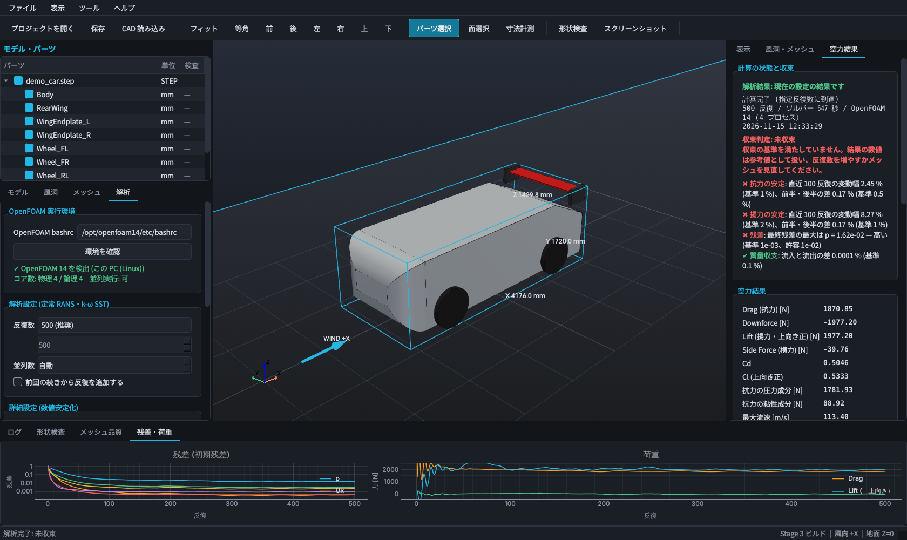

*デモ車両（約 34 万セル）を OpenFOAM 14 で 500 反復解析した画面。右に荷重と収束判定、下に残差と荷重の履歴（Linux 上で実際に動作させて取得）。この例は後流が振動するため、判定は正しく「未収束」になっています。*

> **このビルドで CFD 解析（定常 RANS・k-ω SST）を実行し、Drag / Downforce / Cd / Cl を取得できます。**
> 流れ場は断面・流線・表面分布・等値面として 3D 表示でき、3D ビュー下のスライダーで断面・流線の開始位置・スモーク（粒子）アニメーションの時刻を動かせます。
> v0.7 から、解析した速度場から **立体的な白煙（ボリューム煙）** を作って表示できます（下記「ボリューム煙」）。
> 全体設計は [docs/ARCHITECTURE.md](docs/ARCHITECTURE.md) を参照してください。

### 動作確認の状況（重要）

| 対象 | 状況 |
|---|---|
| Stage 1〜2（Windows 11 実機） | **確認済み**。自動テスト 82 件成功 + 手動確認（ユーザー実施） |
| Stage 1〜6 + v0.7（Linux・Ubuntu 24.04・OpenFOAM 14） | 自動テスト 182 件すべて成功。実物の OpenFOAM 14 で解析・停止・続きから・失敗時の扱い・結果の可視化・粒子アニメーション・レポート出力を確認。指示書の「最終目標」の 11 手順を GUI で通しで実行するテストを含みます |
| Stage 1〜6 の自動テスト（Windows 11 実機） | **確認済み**（ユーザー実施）。141 件成功、14 件スキップ。スキップは、Linux 上の OpenFOAM を直接実行する方式のテストです |
| 書き出した `polyMesh` | OpenFOAM 14 の `checkMesh` が「Mesh OK」と判定。自前の品質指標（非直交性・歪度・体積）は `checkMesh` の値と一致 |
| **Stage 3 を Windows + WSL2 で実行** | **確認済み**（ユーザー実施）。動作確認コマンドが全項目成功し、GUI からデモ車両の 500 反復の解析も完了。停止・続きからの手動操作は **未確認** |
| **ボリューム煙（v0.7）を Windows で実行** | **未確認**。開発機には GPU が無いため、GPU によるボリューム描画（Windows で通常使われる経路）は試せていません。`selftest.bat` の最後の項目で、描画方式と 1 コマの描画時間を確認できます |
| WSL への OpenFOAM 導入スクリプト | 開発環境では **未実行**（ユーザーの WSL には OpenFOAM 14 が導入済みで、アプリから検出できています） |
| 配布パッケージ（PyInstaller） | **Windows 11 でビルド確認済み**（ユーザー実施）。`build_windows.bat` が完了し、できた `ljmcfd-worker.exe` での動作確認（読み込み → メッシュ → OpenFOAM 環境の検出 → GUI 描画）が成功。配布版での CFD 解析の実行と、別の PC へコピーしての起動は **未確認** |

Windows での確認は、まず **動作確認コマンド**（下記「7. 動作確認」）を実行するのが早道です。読み込み → メッシュ → WSL の OpenFOAM での短い解析 → 表示までを
1 回のコマンドで実際に動かし、項目ごとに OK / 失敗 / スキップを表示します。
問題があれば `workspace\logs\selftest.txt` と `workspace\logs\ljmcfd.log` を添えてお知らせください。

---

## セットアップ（Windows 11）

### 1. 必要なもの

- Windows 11 64bit
- [Python 3.12 (64bit)](https://www.python.org/downloads/windows/) — インストール時に「py launcher」を有効にしてください
- OpenGL 3.2 以上に対応した GPU ドライバ
- WSL2 + Ubuntu 24.04 + OpenFOAM Foundation 14（CFD 解析に必要。手順は下の「6. OpenFOAM のセットアップ」）

### 2. 配置

このフォルダ一式を `C:\LJM_CFD_Claude` に置きます（`C:\LJM_CFD_Claude\run_ljm_cfd.bat` がある状態）。

```bat
git clone -b claude/inspiring-turing-aeayw4 https://github.com/EzpaNoLy0o/LunatechJapanModify.github.io.git C:\ljm_tmp
```

```bat
xcopy /E /I C:\ljm_tmp\LJM_CFD_Claude C:\LJM_CFD_Claude
```

> フォルダ名に日本語や空白を含めないでください。OpenCASCADE と OpenFOAM に ASCII パスを渡すためです
> （読み込む CAD ファイル自体は日本語パスにあっても構いません）。

### 3. 依存パッケージのインストール

```bat
C:\LJM_CFD_Claude\scripts\setup_windows.bat
```

`C:\LJM_CFD_Claude\.venv` に仮想環境を作り、PySide6・VTK・PyVista・OpenCASCADE (OCP)・Gmsh などを入れます（約 600 MB）。
テストも実行したい場合は `setup_windows.bat dev` とします。

### 4. 起動

```bat
C:\LJM_CFD_Claude\run_ljm_cfd.bat
```

起動しない・すぐ閉じる場合は、コンソール付きで起動するとエラーが見えます。

```bat
C:\LJM_CFD_Claude\run_ljm_cfd_debug.bat
```

### 5. デモモデル（任意）

手元に CAD が無くても試せるよう、Ahmed ボディと簡易車両アセンブリを生成できます。

```bat
C:\LJM_CFD_Claude\scripts\make_demo_models.bat
```

`C:\LJM_CFD_Claude\demo\` に `ahmed_body.step`、`demo_car.step`、`open_panel.step` が作られます。

---

### 6. OpenFOAM のセットアップ（CFD 解析に必要）

CFD ソルバーは WSL2 の Ubuntu 24.04 で動きます。CAD 読み込みとメッシュ生成だけなら不要です。

**(1) WSL2 と Ubuntu 24.04 を入れる**（管理者のコマンドプロンプトまたは PowerShell）

```bat
wsl --install -d Ubuntu-24.04
```

再起動後、Ubuntu のユーザー名とパスワードを設定します。入っているディストリビューション名は次で確認できます。

```bat
wsl -l -v
```

**(2) OpenFOAM 14 を入れる**

```bat
wsl -d Ubuntu-24.04 -- bash /mnt/c/LJM_CFD_Claude/scripts/setup_wsl_openfoam.sh
```

OpenFOAM Foundation の公式手順（署名鍵の登録 → リポジトリ追加 → `openfoam14` のインストール）を実行します。
途中で Ubuntu のパスワードを求められます。約 650 MB です。

**(3) アプリから確認する**

「解析」タブの「環境を確認」を押し、「✔ OpenFOAM 14 を検出」と表示されれば準備完了です。
ディストリビューション名が `Ubuntu-24.04` 以外の場合は、同じタブの欄に `wsl -l -v` で表示された名前を入力してください。

> **プロジェクトの保存先は英数字だけのパスにしてください**（例 `C:\LJM_CFD_Claude\projects\car01`）。
> 空白や日本語を含むフォルダでは OpenFOAM を実行できないため、解析開始時にエラーになります。

### 7. 動作確認（推奨）

```bat
C:\LJM_CFD_Claude\scripts\selftest.bat
```

小さな直方体を使って、次の経路を実際に動かします（1 分以内）。

| 項目 | 内容 |
|---|---|
| ライブラリの読み込み | PySide6・VTK・OpenCASCADE・Gmsh などのバージョン |
| STEP 読み込みジョブ / メッシュ生成ジョブ | GUI と同じ方法（子プロセス）で実行 |
| OpenFOAM 環境 | WSL の OpenFOAM を検出。**無ければ「スキップ」**（失敗ではありません） |
| CFD 解析 30 反復 | WSL 上で実際に解析（動作確認用の短い計算で、収束した値ではありません） |
| 結果の可視化データ / GUI と 3D 描画 | 断面・流線・粒子の生成、ウィンドウと 3D ビューの描画 |

結果は画面と `workspace\logs\selftest.txt` に出ます。解析を省くには `selftest.bat --no-solver`。

---

## 使い方

### 画面構成

| 位置 | 内容 |
|---|---|
| 左上 | モデル・パーツツリー（チェックで表示／非表示） |
| 左下 | 「モデル」「風洞」「メッシュ」「解析」タブ |
| 中央 | 3D ビュー。解析結果があるときは、その直下に操作バー（断面・流線・スモークのスライダー） |
| 右 | 「表示」「風洞・メッシュ」「空力結果」「可視化」タブ |
| 下 | ログ、形状検査、メッシュ品質、残差・荷重 |

各領域の境界はドラッグで幅・高さを変更でき、次回起動時に復元されます。

### 基本操作

1. **CAD 読み込み**: ツールバー「CAD 読み込み」（`Ctrl+I`）またはファイルをウィンドウへドラッグ＆ドロップ。
   STEP / STP / IGES / IGS / STL に対応。複数ファイルを読み込んで車両全体を構成できます。
2. **視点操作**: 左ドラッグ = 回転、中ドラッグ（または `Shift`+左ドラッグ）= 移動、ホイール = ズーム。
   `F` = フィット、`0`〜`6` = 等角／前／後／左／右／上／下。
3. **パーツ選択** (`Q`): 3D ビューまたはツリーでクリック。`Ctrl`+クリックで追加選択。
4. **面選択** (`W`): 面をクリックすると面積・平均法線・曲面種別を表示。
5. **寸法計測** (`E`): 2 点をクリック。距離と ΔX / ΔY / ΔZ を表示（頂点スナップ切替可）。`Esc` でクリア。
6. **配置・姿勢**: 「モデル」タブで数値入力。
   - パーツ配置 … 選択パーツを個別に移動・回転
   - 車両全体の姿勢 … 全パーツをまとめて移動・回転（Yaw / Pitch / Roll）、「地面に接地」「XY 中心を原点へ」
7. **形状検査** (`Ctrl+Shift+I`): 開放エッジ（赤）・非多様体エッジ（マゼンタ）を 3D 上に表示し、結果を下部の表に一覧。
8. **保存**: `Ctrl+S`。プロジェクトフォルダ（例 `C:\LJM_CFD_Claude\projects\car01`）を選ぶと `project.ljmcfd.json` が作られます。
9. **スクリーンショット**: `F12`。

### 仮想風洞（「風洞」タブ）

1. **解析モード**を選びます。
   - Vehicle Wind Tunnel … 車両全体。地面あり。
   - Component Wind Tunnel … ウイングなど単体パーツ。既定は地面なし（上下対称の余白）。「地面あり」に切り替えも可能。
   - Internal Flow … 未実装（選択できません）。
2. **流れの条件**: 風速（km/h と m/s は連動、既定 200 km/h）、温度、大気圧、空気密度（自動計算または手入力）、乱流強度。
   密度・動粘性・マッハ数・動圧・レイノルズ数がその場で表示されます。
3. **相対風向**: Yaw / Pitch / Roll（「モデル」タブの車両姿勢と同じ値です）。
4. **風洞寸法**: 前方・後方・左右・上方の余白。読み込み時にモデル寸法から自動設定されます（前 3L / 後 6L / 左右 3W / 上 4H）。
   「地面との距離」を入力して「適用」を押すと、モデルの最下点がその高さになります。
5. **「風洞を生成 / 更新」** を押すと 3D に風洞が表示され（青 = 流入、赤 = 流出）、前面投影面積と閉塞率が計算されます。
   Cd・Cl の基準面積は既定で前面投影面積ですが、チェックを外して任意の値に変更できます。

> **接地について**: タイヤのように地面へ線で接する形状は、そのままでは接地部に潰れたセルができます。
> モデルが接地している場合、メッシュ生成時に既定で 10 mm 沈めて接地面を作ります（その分だけ車高が下がります）。
> 量は「接地部の沈み込み」で変更できます。

### メッシュ生成（「メッシュ」タブ）

1. **プリセット**（粗い / 標準 / 細かい）を選ぶか、各サイズを直接入力します（入力すると「カスタム」になります）。
   - 表面サイズ … モデル表面の要素サイズ
   - 最小サイズ … 曲率細分化で許す下限
   - 遠方サイズ・細分化距離 … 表面から離れるにつれてどこまで粗くするか
   - 曲率細分化 … 円 1 周あたりの要素数
   - 後流領域の細分化
2. **パーツ近傍の局所細分化**: パーツごとにサイズ倍率を指定できます（例: ウイングだけ 0.5）。
3. **「メッシュ生成」** を押します。別プロセスで実行され、途中で「停止」できます。
4. 完了すると下部の **「メッシュ品質」** タブに統計・品質・境界パッチ一覧が表示されます。
5. 右の **「風洞・メッシュ」** タブで表面・地面・断面のメッシュを表示できます。
   断面はスライダーまたは座標の数値入力で動かせます（メッシュの再生成は行いません）。


形状・姿勢・風洞・メッシュ設定のいずれかを変えると、メッシュの状態が「再生成が必要」に変わります。
非表示にしたパーツは解析対象から除外されます。

#### 出力

`<プロジェクト>/mesh/` に次が保存されます（未保存の間は `workspace/unsaved/` に置かれ、保存時に移動します）。

| ファイル | 内容 |
|---|---|
| `polyMesh/` | OpenFOAM 形式（points / faces / owner / neighbour / boundary） |
| `volume.vtu` / `boundary.vtp` | 表示用の VTK |
| `mesh_report.json` | 統計・品質・パッチ一覧・設定 |

境界パッチは `inlet` `outlet` `sideL` `sideR` `ground`（または `bottom`）`top` と、パーツごとの壁面パッチです。

#### 境界層プリズム（実験的）と精度について

- **既定のメッシュは四面体のみで、境界層メッシュを持ちません。** この場合、壁面第 1 セルの y+ は数千になり、
  壁関数の適正範囲（30〜300）を大きく外れます。**粘性抗力・剥離位置・Cd の精度は限定的**で、圧力抗力とダウンフォースの
  傾向を比較する用途に留まります。この点はメッシュタブとレポートに常時表示されます。
- 「境界層プリズム」を有効にすると、モデル表面にプリズム層を生成します。ただし
  **モデルが地面・風洞壁に接していない場合に限られ**、形状によっては失敗します（失敗した場合は理由を表示し、
  黙って境界層なしのメッシュにはしません）。
- 接地した車両の境界層メッシュは、STL の形状なら snappyHexMesh で作れます（下記「STL の車体で解析する」）。

### STL の車体で解析する（snappyHexMesh。v0.8）

STL の形状は、OpenFOAM の **snappyHexMesh** でメッシュを作ります（外部空力で標準的な方法。OpenFOAM 同梱の DrivAer チュートリアルと同じ流れ）。
STL のパーツがあると「メッシュ」タブのメッシャーが自動で snappyHexMesh になり、六面体主体のメッシュと **境界層（壁際の薄い層）** を作ります。
OpenFOAM の実行環境（WSL）は解析と同じものを使います。

| 項目 | 扱い |
|---|---|
| 単位 | STL は単位を持たないため寸法から推定します（全長 4,670 なら mm）。ツリーの単位欄に「?」付きで出るので、「モデル」タブで mm になっていることを確認してください。内部はメートルに換算します |
| 1 ファイルに複数の閉じた形状 | そのまま読めます（1 パーツ = 1 パッチ）。**パーツ別の荷重を見るなら、車体・ホイール・フラップを別ファイルで読み込む** のがおすすめです |
| 座標系 | LJM CFD は「風向 +X、車の前が −X、+Z が上、地面 Z = 0」。この向きで作った STL は **そのまま** 使えます（「XY 中心を原点へ」などで動かさない）。+Y の向きは横力の符号だけに関わります |
| タイヤの接地 | 地面に線で接するパーツ（最下点が Z = 0 から 1 mm 以内）だけを「接地部の沈み込み量」（既定 10 mm、「風洞」タブ）だけ下げ、接地長 約 160 mm の接地面を作ります。車体は動かさないので車高は変わりません。STL 側で調整する必要はありません |
| 基準面積 | 既定は前面投影面積の自動計算（ホイール込み）。比較では **値を固定** してください（「風洞」タブで「前面投影面積を使用」を外して入力） |
| 代表長さ | 「風洞」タブの **ホイールベース（代表長さ）** と **前輪軸の位置 X**。前後のダウンフォース配分・Cl 前／後・ピッチングモーメント係数に使います |

**メッシュの細かさ（プリセット）**

| プリセット | 表面のセル | 背景のセル | 境界層 | 全長 4.67 m の車での目安 |
|---|---|---|---|---|
| 粗い | 全長 / 150（31 mm） | 約 1 m | 2 層 | 約 30 万セル |
| 標準 | 全長 / 300（16 mm） | 約 1 m | 3 層 | 約 190 万セル |
| 細かい | 全長 / 425（11 mm） | 約 0.7 m | 3 層 | 約 450 万セル（見積もり） |

粗い → 標準 でセルの大きさが 1/2、標準 → 細かい で 1/√2 です（メッシュ依存性の確認に使える比）。
車体のまわり（全長 × 1.45 程度の範囲）、後流（後端から全長の 1.2 倍）、遠方の後流（3 倍）を段階的に細かくします。
「パーツ別のサイズ倍率」も効きます（0.5 で 1 段階、0.25 で 2 段階細かく）。**薄い板（フラップ）は 0.25〜0.5 を指定** してください。
snappyHexMesh は板の厚みがセル 2 個ぶん以上ないと表せません。

**比較のための固定**（「メッシュ」タブ）: 「計算領域とメッシュの基準寸法を、今の値に固定する」にチェックを入れると、
形状（フラップなど）を足して外形が変わっても、計算領域・セルの大きさ・細分化の範囲が変わりません。
差（ΔCd・ΔCl）にメッシュの違いが混ざらないよう、**基準ケースで固定してから** 追加の形状を読み込みます。

**前後のダウンフォース配分**: 空力荷重を前輪・後輪の接地点で支えたときに、各車軸が受け持つ荷重です。
前輪の接地点まわりのピッチングモーメント（抗力が高い位置で働く効果も含む）を、ホイールベースで割って後輪側を求めます。
ホイールベースや前輪軸の位置を後から変えても、解析をやり直さずに計算し直します。

### CFD 解析（「解析」タブ）

1. **反復数**を選びます（200 / 300 / 500 / 700 / 1000 / 任意の値。推奨 500）。
2. **「解析開始」** を押します。OpenFOAM は別プロセス（WSL 側）で動き、その間も GUI は操作できます。
   - 下部の **「残差・荷重」** タブに、残差と Drag / Lift の履歴が反復ごとに描かれます。
   - **「停止」** を押すと、その時点の結果を保存して終了します（途中結果として表示されます）。
3. 完了すると右の **「空力結果」** タブに結果が表示されます。

実行される内容: ケース生成 → `checkMesh` → `renumberMesh` → `potentialFoam`（初期化）→ `foamRun`（必要なら並列）→ `foamToVTK`。

| 設定 | 内容 |
|---|---|
| 並列数 | 自動 = 物理コア数とセル数から決定（1 プロセスあたり 2.5 万セル以上） |
| 前回の続きから | 前回の解から反復を追加します。外すと最初から再計算します |
| 緩和係数 | 既定は 圧力 0.3 / 速度 0.7 / 乱流 0.7。発散する場合は下げてください |
| 非直交補正 | 自動 = メッシュの最大非直交性から決定（四面体メッシュでは通常 1 回） |
| 残差の打ち切り基準 | すべての残差がこの値を下回ると、指定反復数より前に終了します |

数値設定: 定常・非圧縮 RANS（`incompressibleFluid`）、k-ω SST、対流項は有界な 2 次風上、勾配はセルリミッタつき、
壁面は全 y+ 域で使える壁関数（`nutUSpaldingWallFunction`）。地面は Moving Ground なら主流速度で動く壁、そうでなければ静止壁です。

#### 結果の見方

| 項目 | 意味 |
|---|---|
| Drag | 風向（+X）方向の力 |
| Lift | 上向き（+Z）を正とした力 |
| **Downforce** | **−Lift**（下向きを正とした値）。Lift と符号が逆になるだけです |
| Side Force | +Y 方向の力 |
| Cd・Cl | 力 ÷（動圧 × 基準面積）。基準面積は「風洞」タブで確認・変更でき、変えると係数だけが追従します |
| 抗力の圧力成分・粘性成分 | Drag の内訳 |
| 最大・最小圧力 | 流出面を基準としたゲージ圧 [Pa] |

- 荷重は **直近の区間（全反復の 20 %、最低 50 反復）の平均** です。変動幅も併記されます。
- 車両にヨー角を付けた場合も、力は風洞座標（風向基準）で表します。
- パーツが複数ある場合は、パーツ別の Drag と Downforce も表示されます。
- 値を取得できない場合は「未計算」「計算失敗」「基準面積が未設定」と表示し、推測値は出しません。

#### 「計算完了」と「収束」は別です

指定した反復数を回り切っただけでは収束とはみなしません。次の 3 点を調べて判定します。

| 確認項目 | 基準 |
|---|---|
| 抗力の安定 | 直近区間の変動幅が平均の 1 % 以内、かつ区間の前半と後半の平均の差が 0.5 % 以内 |
| 揚力の安定 | 同じく 2 % 以内、1 % 以内（基準値は 揚力の絶対値 と 抗力の 10 % の大きい方） |
| 残差 | 最終残差の最大が 1e-3 以下なら「十分低い」、1e-2 以下なら「やや高い」 |
| 質量収支 | 流入と流出の体積流量の差が 0.1 % 以内 |

| 判定 | 条件 |
|---|---|
| 工学的に十分収束 | 荷重が安定、残差が十分低い、質量収支が良好 |
| 概ね収束 | 荷重は安定しているが、残差がやや高い |
| 未収束 | 上記を満たさない。数値は参考値として扱ってください |
| 判定不能 | 反復数が 100 未満 |
| 発散 | ソルバーが異常終了、または数値が非数になった（結果は表示しません） |

後流が大きく振動する形状（鈍頭な物体、大きな剥離）は、定常 RANS では荷重が振れ続けて「未収束」になることがあります。
これは判定の誤りではなく、定常計算の限界です。

#### 精度について（必ずお読みください）

結果には、精度に関する注意書きが自動で付きます。

- **境界層メッシュが無い場合**、粘性抗力・剥離位置・Cd の精度は限定的です。
  Ahmed ボディ（スラント角 25°、約 9.7 万セルの粗い四面体・境界層なし）での検証では **Cd = 0.352** で、
  文献の実験値 0.285 より約 23 % 高く出ました。**絶対値ではなく、形状変更前後の傾向比較** に使ってください。
- 実際の y+（壁面ごとの平均・最小・最大）が表示されます。壁関数の適正範囲は 30〜300 です。
- 圧力係数 Cp の最大値が 1 を大きく超える場合、メッシュの粗さによる数値的な行き過ぎが疑われる旨を表示します。
- ホイールは回転しません（Moving Ground でも静止した壁として扱います）。

#### 出力

`<プロジェクト>/case/` に OpenFOAM のケース、`<プロジェクト>/results/` に次が保存されます。

| ファイル | 内容 |
|---|---|
| `summary.json` | 荷重・係数・収束判定・y+・注意書き |
| `history.csv` | 反復ごとの残差と荷重（圧力成分・粘性成分） |
| `fields.vtu` / `surface/*.vtp` | 流れ場と壁面の VTK（流速・圧力・Cp・渦度・Q 値・k・y+ など。Stage 4 以降の可視化で使用） |

### 流れ場の可視化（「可視化」タブ）

解析が終わると、右の「可視化」タブで流れ場を 3D 表示できます。表示は計算済みの結果から抽出するだけで、解析は再実行しません。

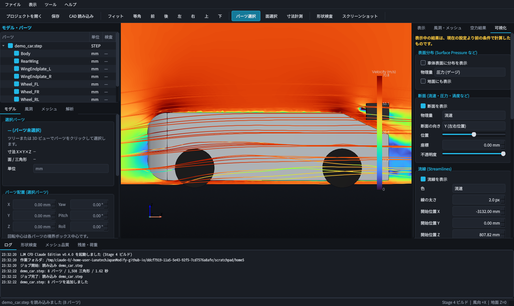

| レイヤー | 内容 |
|---|---|
| 表面分布 | 車体表面の圧力・Cp・壁面せん断応力・y+（Surface Pressure）。表示中は CAD 形状を隠します |
| 断面 | X・Y・Z に垂直な断面に、流速・圧力・Cp・渦度・乱流エネルギー・Q 値を表示。位置はスライダーか座標の数値入力（3D ビュー下の操作バーからも動かせます） |
| 流線 | 開始面（位置 X・Y・Z、幅、高さ、本数、間隔）から速度場に沿って積分。色は物理量または単色。線の太さを変更可能 |
| 等値面 | 任意の物理量が指定値になる面。既定は流速（主流の半分の速さ = 後流の外形）。Q 値にすると渦の中心部 |

- **カラースケール**: 物理量ごとに、自動または最小値・最大値の手動指定。カラーマップも選べます。
  同じ物理量を使うレイヤー（例: 断面と流線の流速）はスケールを共有します。
- 流線の開始面は、初回に車両前面へ自動配置されます。「車両前面に配置」でいつでも戻せます。
- モデルを半透明にするには「表示」タブの「モデル不透明度」を使います。
- 表示設定はプロジェクトに保存され、再読み込み時に復元されます。

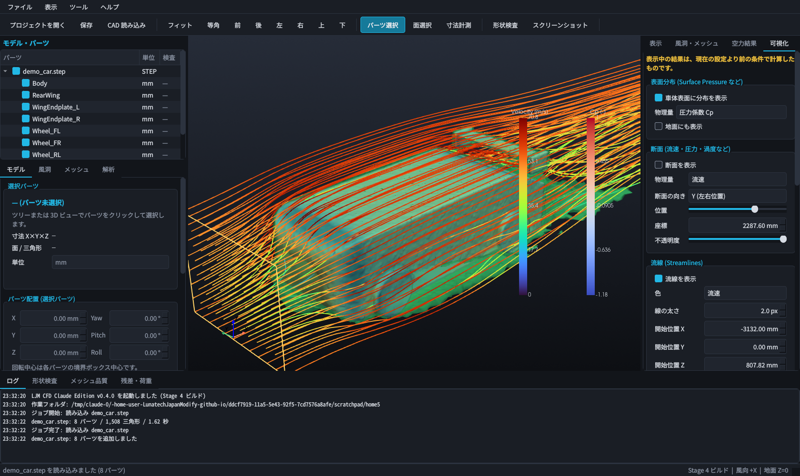

注意点:

- 定常 RANS の結果なので、**流線は定常の速度場に沿った軌跡** です。時間変化する流れの記録ではありません。
- Q 値は、境界層メッシュの無い粗いメッシュでは壁面近くにノイズが出ます。
- 流れ場はメッシュ生成時の位置（接地時は既定で 10 mm 沈めた位置）にあるため、CAD 表示とは高さがその分だけずれます。

### スライダー操作とスモーク・粒子アニメーション（3D ビュー下の操作バー）

解析結果があると、3D ビューのすぐ下に操作バーが現れます。3 本のスライダーは **互いに独立** で、
どれを動かしても計算済みの結果から表示を作り直すだけです（OpenFOAM は再実行しません）。

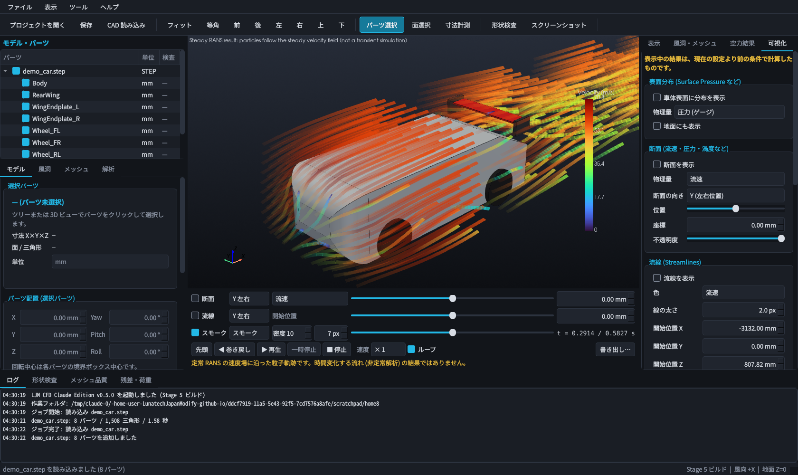

| 行 | 操作 |
|---|---|
| **断面** | チェックで表示。向き（X 前後 / Y 左右 / Z 高さ）と物理量（流速・圧力・Cp・渦度・乱流エネルギー・Q 値）を選び、スライダーをドラッグすると断面がその場で動きます。右の欄に現在位置が mm / m で表示され、数値入力もできます |
| **流線** | チェックで表示。動かす軸（X / Y / Z）を選び、スライダーで流線の開始位置を動かします。幅・高さ・本数・間隔は右の「可視化」タブで設定します |
| **スモーク** | チェックで表示。「スモーク」（尾を引く半透明の筋）か「粒子」（点）を選びます。右のスライダーが **タイムライン** で、右へ動かすと粒子が下流へ進み、左へ戻すと前の位置へ正確に戻ります |
| 再生操作 | 先頭 / ◀ 巻き戻し（逆再生）/ ▶ 再生 / 一時停止 / ■ 停止（先頭へ戻る）、再生速度（× 0.25〜× 4）、ループ再生、粒子密度（流線 1 本あたりの粒子数）、大きさ |
| 書き出し… | タイムライン 1 周分をアニメーション GIF または PNG 連番で保存します（「ファイル」メニューにもあります） |

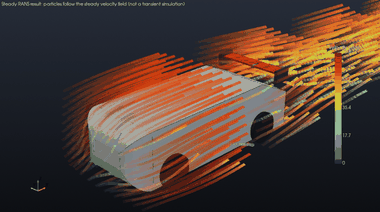

- 粒子・スモークは流線の開始面から放出されます。開始面を動かすと粒子も付いていきます（流線を表示していなくても使えます）。
- 色は流速です（カラースケールは流線・断面の流速と共有）。
- スライダーや再生の設定はプロジェクトに保存されます（再生中かどうかは保存されず、開いた直後は停止しています）。

> **重要: これは定常解析の結果です。** 粒子は「定常 RANS で求めた 1 つの速度場」に沿って動いているだけで、
> 時間とともに変化する流れ（渦の放出など）を再現したものではありません。タイムラインの時間は、粒子がその速度場の中を進む時間です。
> 誤解を避けるため、粒子表示中は操作バーと 3D ビュー内（スクリーンショット・書き出した動画にも残ります）に注記を表示します。
> 非定常解析は未対応です。

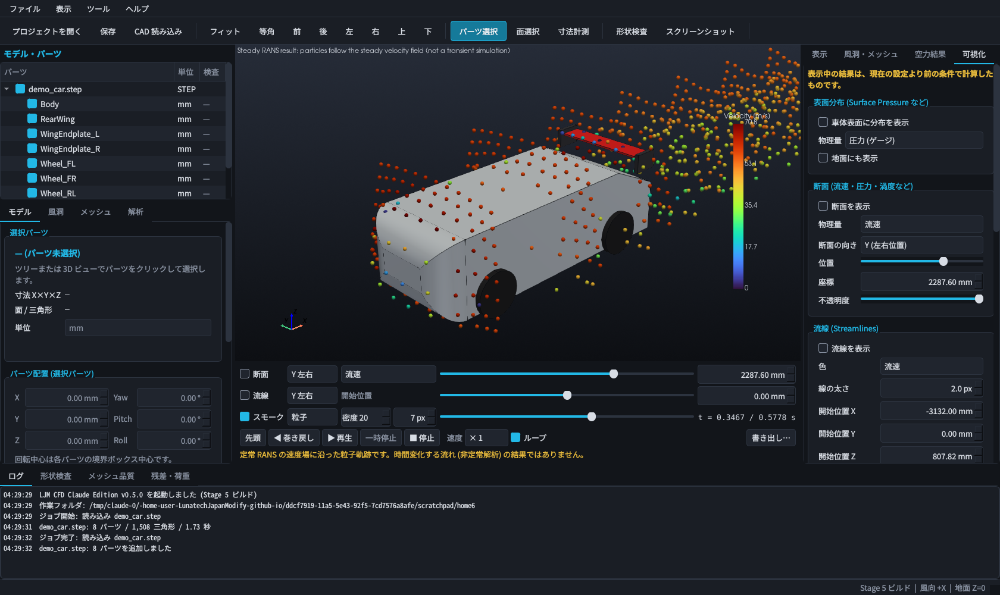

### ボリューム煙（立体的な白煙。v0.7）

解析した速度場から、風洞のスモークテストのような **連続した半透明の白煙** を作って表示します。
点の集まりではなく、空間の濃度分布（ボクセル格子）をレイキャスティングで立体的に描くので、車両を回しても煙の形が保たれます。

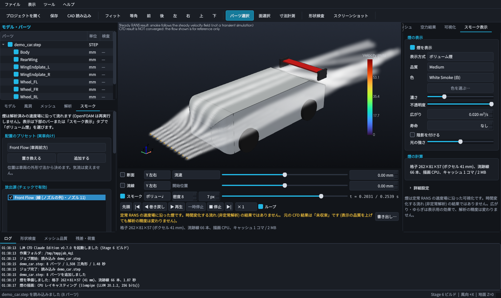

**使い方**

1. 解析結果がある状態で、3D ビュー下のバーの表示方式を「ボリューム煙」にし、「スモーク」にチェックを入れます。
   煙の計算はバックグラウンドで行い（デモ車両で約 2 秒）、その間も GUI は操作できます。
2. 放出源は左の「スモーク」タブで設定します。初回は車両の寸法から「Front Flow」（車両前方のノズル列）を自動で置きます。
3. 見た目は右の「スモーク表示」タブで変えます。タイムラインは操作バーのものをそのまま使います（再生・一時停止・停止・巻き戻し・コマ送り・ループ・速度）。

| 放出源のプリセット | 置き方 |
|---|---|
| Front Flow | 車両前方に横一列のノズル |
| Underfloor Flow | フロント下面の前方から床下へ |
| Diffuser Flow | 車体下面の後半から後方へ |
| Rear Wing Flow | リアウイング前方・上方のノズルの格子 |
| Wheel Wake | 左右のタイヤの前方 |
| Custom | 自由配置（点・線・面・格子。位置・幅・高さ・ノズル数・初期の太さ・放出量・放出開始・終了・間欠放出） |

プリセットは「置き換える」と「追加する」を選べ、複数の放出源を同時に使えます。プリセットは煙の出る位置を決めるだけで、気流は変えません。

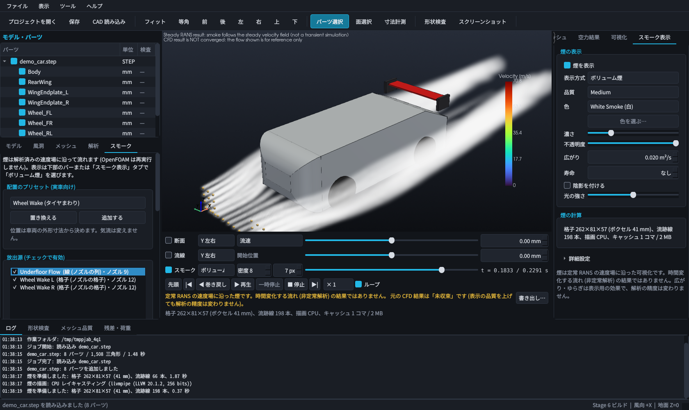

| 表示方式（操作バー） | 内容 |
|---|---|
| ボリューム煙 | 立体的な連続した煙（既定の品質 Medium） |
| 高品質ボリューム煙 | High 以上の格子、細かいサンプリング、柔らかい陰影 |
| 筋（スモーク）/ リボン / チューブ / 粒子 | 流線の開始面から放出する従来の表示（リボン・チューブは補助的な表示） |

| 設定（「スモーク表示」タブ） | 内容 | 変えたときに計算し直すもの |
|---|---|---|
| 品質 | 格子の細かさ（Low 約 26 万・Medium 約 118 万・High 約 315 万・Ultra 約 1060 万ボクセル） | 煙の通り道と格子 |
| 色 | White / Light Gray / Dark Gray / 流速で色付け / 任意の色 | **なし**（描画だけ） |
| 濃さ・不透明度・陰影 | 光学的な濃さ（吸収係数）、全体の不透明度、密度の勾配による陰影 | **なし**（描画だけ） |
| 広がり | 表示用の広がり係数 D（煙の太さ σ² = σ0² + 2·D·t）。**OpenFOAM の乱流拡散ではありません** | 濃度場の準備だけ |
| 寿命 | これより古い煙を消す | 濃度場のコマだけ |
| 放出源の位置・量 | — | 煙の通り道（OpenFOAM の結果は使い回し） |

カメラの回転・ズーム、色・濃さの変更では、煙の計算は一切やり直しません。

**詳細設定**（折りたたみ）: ボクセル数、ノズル 1 本の流跡線数、流跡線の標本間隔、レイキャスティングの間隔、キャッシュの上限（既定 512 MB）、
流跡線の上限本数、描画方式（自動 / GPU / CPU）、輸送モデル、タイムラインの長さ、視覚効果のゆらぎ（**CFD の結果ではない表示だけの効果。既定は OFF**）。

**しくみと精度**

- 煙は解析済みの速度場 U だけで動きます（dx/dt = U(x)）。定常の速度場では、1 点から連続して出した煙の列は、その点からの流跡線と一致します。
  そこでノズルごとの流跡線を「経過時間」で等間隔に標本化しておき、時刻 t の煙は「放出時刻 t − 経過時間 に放出していた標本」をガウス分布として格子へ足し込んで作ります。
  同じ時刻には必ず同じ煙になり、タイムラインを戻すと正確に元の煙に戻ります（逆向きに動かす近似は使っていません）。
- 流れの遅い所ほど標本が詰まり、煙が濃くなります（実際の煙と同じ）。煙の総量は、標本数・格子の細かさを変えても変わりません（自動テストで確認）。
- 車体の内部は流体マスク（解析メッシュのセルがある所 = 流体）で判定し、煙を置きません。ぼかしで車体側へはみ出した分は流体側へ戻します。
- 不透明度は α = 1 − exp(−κ ρ Δs) で、描画のサンプル間隔を変えても煙の濃さは変わりません。
- **輸送モデル「受動スカラー方式」**（詳細設定）: 煙を濃度として ∂c/∂t + ∇·(Uc) = ∇·(D∇c) + S − λc で移流・拡散させる方式です（セミラグランジュ法）。
  コマを先頭から順に計算するため、途中の時刻へ飛ぶと計算が届くまで少し待ちます（その間も GUI は操作できます）。
  補間による **数値拡散**（Medium 格子のデモ車両で目安 0.29 m²/s）があり、煙は流跡線方式よりぼやけます。状態の表示に CFL 数と数値拡散の目安を出します。

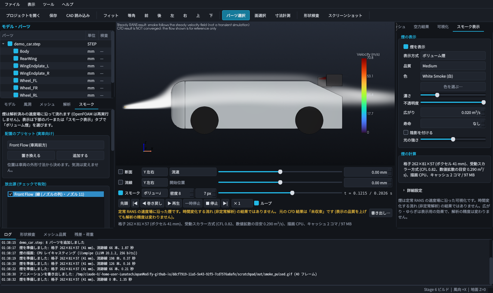

> **重要:** 煙は定常 RANS の速度場に沿った可視化です。渦の放出などの時間変化する流れは現れません。
> 表示中は 3D ビュー内と操作バーにその旨を、元の CFD 結果が未収束の場合はそのことも表示します。
> 煙の見た目を良くしても、CFD 解析の精度は変わりません。

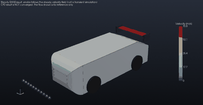

### 解析レポートの書き出し

「ファイル」→「解析レポートを書き出し…」（`Ctrl+R`。「空力結果」タブの下にも同じボタンがあります）で、選んだフォルダの中に
日時の名前のフォルダを作り、次のファイルを保存します。書き出し後、レポートが既定のブラウザで開きます。

| ファイル | 内容 |
|---|---|
| `report.html` | 1 ファイルで完結するレポート（ブラウザで開く。印刷可）。計算の状態、収束判定、Drag / Downforce / Cd / Cl、精度に関する注意、書き出し時の 3D ビュー、残差・荷重の履歴グラフ、パーツ別の荷重、解析条件、風洞、メッシュ品質、モデル |
| `summary.csv` | 「節・項目・値・単位」の一覧（Excel で開けます） |
| `parts.csv` | パーツ別の荷重と y+（複数パーツの解析のとき） |
| `history.csv` | 反復ごとの残差と荷重 |
| `report.json` | 元データ |
| `view.png` | 書き出し時の 3D ビュー |

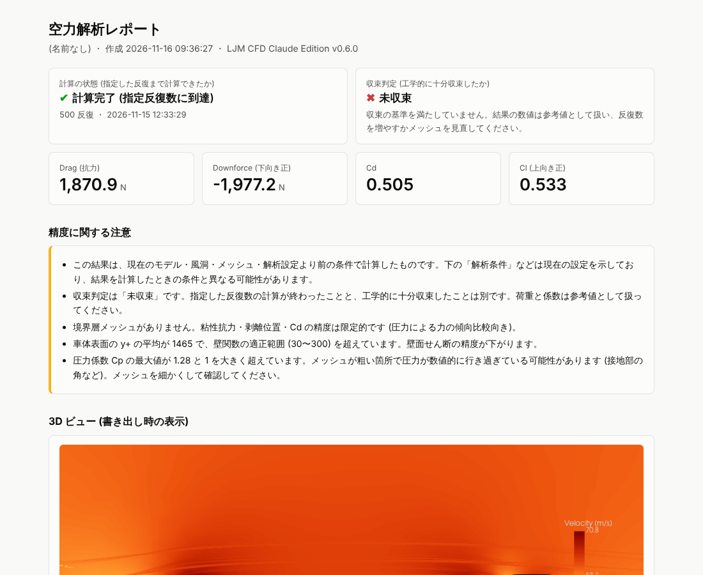

- **「計算の状態」と「収束判定」を別々に** 表示します。指定した反復数の計算が終わっても、収束したとは限りません。
- 計算していない値は「未計算」、解析が失敗した場合は「計算失敗」と書き、数値は入れません。解析前でも書き出せます。
- 設定を変えた後に再計算していない場合は、「現在の設定より前の条件で計算した結果」であることを先頭に書きます。
- 境界層メッシュが無いことなど、精度に関する注意を必ず載せます。
- グラフにマウスを乗せると、その反復の値が表示されます（← → キーでも移動できます）。

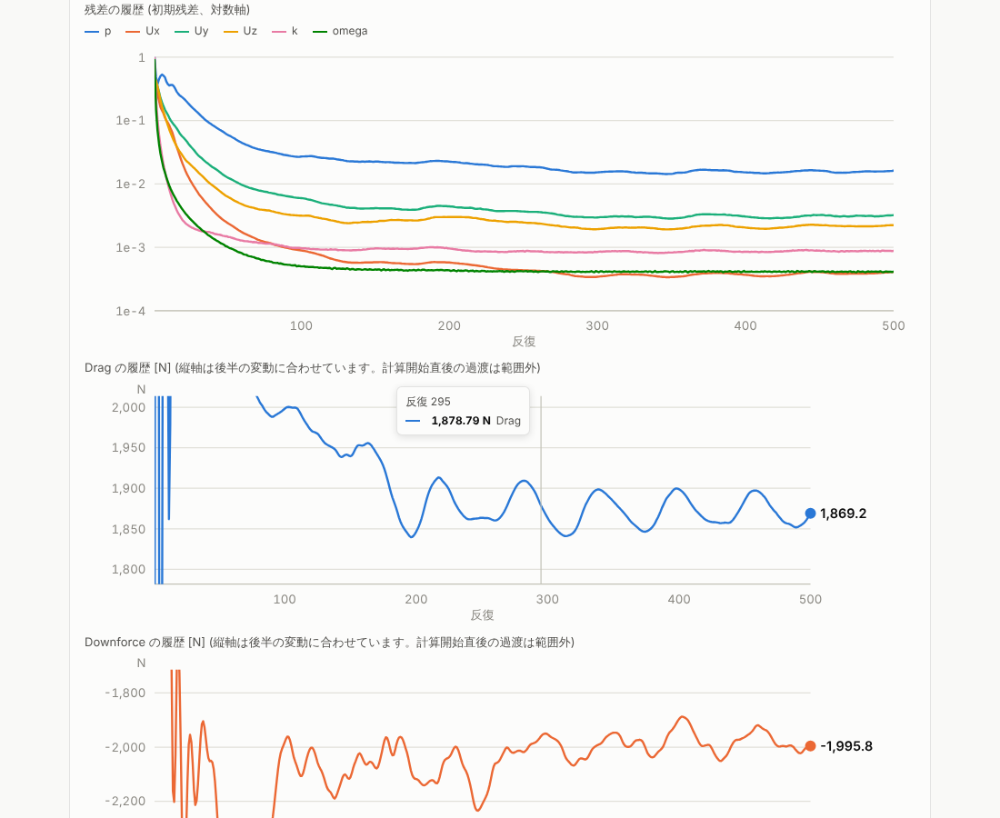

### 座標系の約束

- 風向は常に **+X**。車両はノーズを **−X**（上流側）へ向けて置きます。
- **+Z** が上、地面は **Z = 0**。
- 相対風向（ヨー角など）は、風ではなく車両側の姿勢で与えます。

### 単位について

- **STEP / IGES**: ファイル内の単位を検出し、CAD カーネルが mm へ自動換算します。
- **STL**: 単位情報を持たないため、寸法から mm / m を **推定** します（ツリーに `?` 付きで表示、ログに警告）。
  必ず「モデル」タブの「単位」で確認し、違っていれば変更してください。
- 表示単位（mm / m）は右パネルで切り替えられます。内部計算は常に SI（m）です。

---

## ファイルの置き場所

| パス | 内容 |
|---|---|
| `workspace\cache\cad\` | CAD 変換キャッシュ（削除しても再生成されます） |
| `workspace\logs\ljmcfd.log` | アプリのログ |
| `workspace\logs\crash.log` | 異常終了時のスタック |
| `workspace\settings.ini` | ウィンドウ配置などの設定 |
| `projects\<名前>\project.ljmcfd.json` | 解析プロジェクト（設定のみ。メッシュや結果は埋め込みません） |
| `projects\<名前>\mesh\` `case\` `results\` | メッシュ、OpenFOAM ケース、解析結果 |
| `projects\<名前>\reports\` `screenshots\` `animations\` | レポート、スクリーンショット、書き出したアニメーション（保存先の既定値） |
| `workspace\logs\selftest.txt` | 動作確認コマンドの結果 |

作業フォルダは環境変数 `LJMCFD_HOME` で変更できます。

## テスト

```bat
C:\LJM_CFD_Claude\scripts\run_tests.bat
```

実際にアプリのウィンドウが開閉します（数分。Linux の開発機で 182 件・約 4 分半）。OpenFOAM を使うテストは、Windows では自動的にスキップされます
（テストは Linux 上の OpenFOAM を直接実行する方式のため）。Linux では仮想ディスプレイを使います。

```bash
xvfb-run -a python -m pytest
```

## 配布用パッケージ（Python なしで起動できるフォルダ）

```bat
C:\LJM_CFD_Claude\scripts\build_windows.bat
```

PyInstaller で `dist\LJM_CFD_Claude\` フォルダを作ります（数分、約 1.5 GB）。フォルダごとコピーすれば、Python を入れていない PC でも
`LJM_CFD_Claude.exe` で起動できます。ビルドの最後に、できあがった実行ファイルで動作確認（解析を除く）を自動実行します。

| ファイル | 役割 |
|---|---|
| `LJM_CFD_Claude.exe` | アプリ本体（コンソールなし） |
| `ljmcfd-worker.exe` | 読み込み・メッシュ生成・解析のジョブ用。本体が自動で起動します。`ljmcfd-worker.exe --self-test` で動作確認もできます |
| `_internal\` | ライブラリ一式 |

- OpenFOAM は含みません。配布先の PC にも WSL2 と OpenFOAM 14 が必要です（上記「6. OpenFOAM のセットアップ」）。
- 作業フォルダ（`workspace`）は実行ファイルの隣に作られます。英数字だけのパスで、書き込みできる場所に置いてください（`C:\Program Files` は不可）。
- Windows 11 でのビルドと、ビルドした実行ファイルでの動作確認（解析を除く）は確認済みです。配布版で解析まで確かめるには
  `dist\LJM_CFD_Claude\ljmcfd-worker.exe --self-test` を実行してください。

## 既知の制限

- 解析は定常 RANS のみです。非定常解析、ホイールの回転、ラジエーターなどの多孔質体には未対応です。
- スモーク・粒子アニメーションは定常の速度場に沿った軌跡で、時間変化する流れの再現ではありません（上記）。
- 動画の書き出しは GIF と PNG 連番のみです（MP4 は未対応。エンコーダー（ffmpeg）を配布物に同梱する必要があるため見送りました）。GIF は 256 色のため色の階調が粗くなります。
- ボリューム煙の受動スカラー方式は、補間による数値拡散が大きく（Medium 格子で設定値の 10 倍程度）、車体の壁際で煙の量が 2 割ほど失われます（デモ車両での測定）。形を細かく見るには流跡線方式（既定）を使ってください。
- ボリューム煙の放出源プリセットは車体の外形寸法から位置を決めるため、ウイングやディフューザーの実際の位置とはずれることがあります（位置は調整できます）。
- ボリューム煙の GPU 描画は、開発機に GPU が無いため未確認です。
- レポートの形式は HTML と CSV です（PDF が必要な場合は、ブラウザの印刷機能で PDF にできます）。
- 既定のメッシュは境界層を持たないため、Cd の絶対値の精度は限定的です（上記「精度について」）。
- STL のパーツのメッシュは snappyHexMesh（OpenFOAM）で作ります。STL は閉じた形状（水密）である必要があります。Gmsh の経路（四面体）は STEP / IGES が対象です。
- snappyHexMesh のメッシュ生成を「停止」したとき、Windows では WSL 内の snappyHexMesh が止まらずに残る可能性があります（未確認）。
- 開いたサーフェスのパーツは自動で縫い合わせを試みますが、閉じたソリッドにならなければエラーになります。
- 境界層プリズムは実験的機能で、接地した形状には使えません（上記）。
- 左右対称の半分モデルによる計算量削減には未対応です。
- IGES は読み込めますが、面同士がつながっていないサーフェス集合になることが多く、形状検査で開放エッジとして報告されます。
- パーツ数が 300 を超えるファイルは、表示性能のため 1 パーツへ統合されます。
- 形状検査は約 200 万三角形で 12 秒程度かかります（バックグラウンド実行のため操作は可能）。
- 形状の修復機能（穴埋め・縫合）はありません。検査で不良が見つかった場合は CAD 側で修正してください。

## 性能の目安（開発機: 4 コア・ソフトウェア描画での実測）

| メッシュ生成（デモ車両 8 パーツ） | セル数 | 時間 |
|---|---|---|
| 粗い | 約 11 万 | 約 4 秒 |
| 標準 | 約 34 万 | 約 8 秒 |
| 細かい | 約 87 万 | 約 19 秒 |
| Ahmed ボディ・細かい + 境界層 8 層 | 約 134 万 | 約 51 秒 |

| CFD 解析（OpenFOAM 14、4 プロセス） | セル数 | 500 反復の時間 |
|---|---|---|
| Ahmed ボディ・粗い | 約 9.7 万 | 約 50 秒 |
| デモ車両・標準 | 約 34 万 | 約 7 分（0.88 秒 / 反復） |

| モデル | 読み込み | 2 回目以降（キャッシュ） |
|---|---|---|
| STL 約 200 万三角形（100 MB） | 約 8 秒 | 約 1 秒 |
| STEP 406 面 → 10 万三角形 | 約 6 秒 | 0.1 秒未満 |

読み込みは別プロセスで行うため、その間も GUI は操作できます。

| 可視化（デモ車両・約 34 万セル。描画は GPU なしのソフトウェア描画） | 時間 |
|---|---|
| 断面スライダー 1 回の更新（断面の切り直し） | 約 15 ms + 描画 |
| 流線の開始位置スライダー 1 回の更新（96 本の流線を引き直し + スモーク） | 約 0.2 秒 |
| スモークを初めて有効にしたとき（流跡線の事前計算） | 約 0.3 秒 |
| タイムライン 1 コマの粒子位置の更新（約 9,000 点） | 約 1 ms |
| 3D ビューの描画 1 回 | 約 20〜30 ms（再生は約 24 コマ / 秒） |

GPU のある Windows 機では描画はこれより速いはずですが、**未確認** です。

| ボリューム煙（デモ車両・約 34 万セル。GPU なしのソフトウェア描画 = CPU レイキャスティング） | Low | Medium（既定） | High |
|---|---|---|---|
| ボクセルの大きさ（Front Flow） | 67 mm | 41 mm | 29 mm |
| 煙の準備（流跡線 + 流体マスク、設定変更時のみ。バックグラウンド） | 約 0.6 秒 | 約 1.7 秒 | 約 2.9 秒 |
| 濃度場 1 コマの計算（キャッシュに無いとき） | 5〜8 ms | 18〜37 ms | 55〜100 ms |
| 3D ビューの描画 1 回（陰影なし、950 × 490 px） | 約 60〜100 ms | 約 60〜100 ms | 約 130 ms |
| 濃度場 1 コマのメモリ（キャッシュは半精度） | 0.5 MB | 2.4 MB | 6.3 MB |

ソフトウェア描画では、CPU のレイキャスティングのほうが GPU 用の描画より速い（同じ条件で 31 ms 対 160 ms）ため、GPU が無いと判定したときは自動で CPU を使います。
受動スカラー方式は Medium 格子で 1 ステップ約 54 ms（タイムライン全体で約 26 秒、バックグラウンドで計算）。
GPU のある Windows 機での速さは **未確認** です（`selftest.bat` で 1 コマの描画時間を表示します）。
