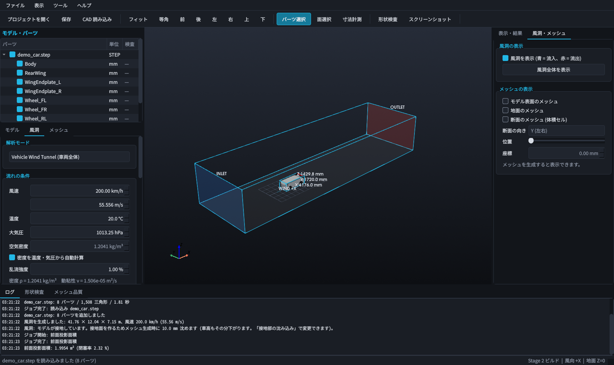

# LJM CFD — Claude Edition

Windows 11 用の自動車空力解析ワークベンチです。STEP などの車両・エアロパーツを読み込み、
仮想風洞で CFD 解析を行い、結果をスライダー操作で観察できるソフトウェアを段階的に開発しています。

既存の「LJM CFD Beta 0.6.2.3」とは **独立した新規プロジェクト** で、既存アプリのファイルは一切変更しません。

## 現在の実装状況

| Stage | 内容 | 状態 |
|---|---|---|
| 1 | GUI、3D 表示、STEP / IGES / STL 読み込み、モデル操作、形状検査 | **実装済み** |
| 2 | 仮想風洞、メッシュ生成、メッシュ品質チェック、OpenFOAM 形式への変換 | **実装済み** |
| 3 | OpenFOAM 連携、CFD 解析、荷重計算、収束判定 | **実装済み**（Windows + WSL での実行は未確認） |
| 4 | 速度・圧力・流線などの 3D 可視化 | 未実装 |
| 5 | 断面スライダー、流線開始位置スライダー、スモーク・粒子アニメーション | 未実装 |
| 6 | 結果出力、パフォーマンス改善、Windows 用パッケージング | 未実装（プロジェクト保存は Stage 1〜3 の範囲で実装済み） |


*デモ車両（約 34 万セル）を OpenFOAM 14 で 500 反復解析した画面。右に荷重と収束判定、下に残差と荷重の履歴（Linux 上で実際に動作させて取得）。この例は後流が振動するため、判定は正しく「未収束」になっています。*

> **このビルドで CFD 解析（定常 RANS・k-ω SST）を実行し、Drag / Downforce / Cd / Cl を取得できます。**
> 流れ場の 3D 可視化（流線・断面・粒子）は Stage 4〜5 で、まだ実装されていません。
> 全体設計は [docs/ARCHITECTURE.md](docs/ARCHITECTURE.md) を参照してください。

### 動作確認の状況（重要）

| 対象 | 状況 |
|---|---|
| Stage 1〜2（Windows 11 実機） | **確認済み**。自動テスト 82 件成功 + 手動確認（ユーザー実施） |
| Stage 1〜3（Linux・Ubuntu 24.04・OpenFOAM 14） | 自動テスト 106 件すべて成功。実物の OpenFOAM 14 で解析・停止・続きから・失敗時の扱いを確認 |
| 書き出した `polyMesh` | OpenFOAM 14 の `checkMesh` が「Mesh OK」と判定。自前の品質指標（非直交性・歪度・体積）は `checkMesh` の値と一致 |
| **Stage 3 を Windows + WSL2 で実行** | **未確認**。`wsl.exe` 経由の起動・`/mnt/c` 上での実行は、開発環境（Linux）では試せていません |
| WSL への OpenFOAM 導入スクリプト | **未実行**。公式手順と同じ内容ですが、開発環境では試せていません |

Stage 3 を Windows で初めて動かすときは、まず「解析」タブの「環境を確認」を押してください。
問題があれば `workspace\logs\ljmcfd.log` を添えてお知らせください。

---

## セットアップ（Windows 11）

### 1. 必要なもの

- Windows 11 64bit
- [Python 3.12 (64bit)](https://www.python.org/downloads/windows/) — インストール時に「py launcher」を有効にしてください
- OpenGL 3.2 以上に対応した GPU ドライバ
- WSL2 + Ubuntu 24.04 + OpenFOAM Foundation 14（CFD 解析に必要。手順は下の「6. OpenFOAM のセットアップ」）

### 2. 配置

このフォルダ一式を `C:\LJM_CFD_Claude` に置きます（`C:\LJM_CFD_Claude\run_ljm_cfd.bat` がある状態）。

```bat
git clone -b claude/inspiring-turing-aeayw4 https://github.com/EzpaNoLy0o/LunatechJapanModify.github.io.git C:\ljm_tmp
```

```bat
xcopy /E /I C:\ljm_tmp\LJM_CFD_Claude C:\LJM_CFD_Claude
```

> フォルダ名に日本語や空白を含めないでください。OpenCASCADE と OpenFOAM に ASCII パスを渡すためです
> （読み込む CAD ファイル自体は日本語パスにあっても構いません）。

### 3. 依存パッケージのインストール

```bat
C:\LJM_CFD_Claude\scripts\setup_windows.bat
```

`C:\LJM_CFD_Claude\.venv` に仮想環境を作り、PySide6・VTK・PyVista・OpenCASCADE (OCP)・Gmsh などを入れます（約 600 MB）。
テストも実行したい場合は `setup_windows.bat dev` とします。

### 4. 起動

```bat
C:\LJM_CFD_Claude\run_ljm_cfd.bat
```

起動しない・すぐ閉じる場合は、コンソール付きで起動するとエラーが見えます。

```bat
C:\LJM_CFD_Claude\run_ljm_cfd_debug.bat
```

### 5. デモモデル（任意）

手元に CAD が無くても試せるよう、Ahmed ボディと簡易車両アセンブリを生成できます。

```bat
C:\LJM_CFD_Claude\scripts\make_demo_models.bat
```

`C:\LJM_CFD_Claude\demo\` に `ahmed_body.step`、`demo_car.step`、`open_panel.step` が作られます。

---

### 6. OpenFOAM のセットアップ（CFD 解析に必要）

CFD ソルバーは WSL2 の Ubuntu 24.04 で動きます。CAD 読み込みとメッシュ生成だけなら不要です。

**(1) WSL2 と Ubuntu 24.04 を入れる**（管理者のコマンドプロンプトまたは PowerShell）

```bat
wsl --install -d Ubuntu-24.04
```

再起動後、Ubuntu のユーザー名とパスワードを設定します。入っているディストリビューション名は次で確認できます。

```bat
wsl -l -v
```

**(2) OpenFOAM 14 を入れる**

```bat
wsl -d Ubuntu-24.04 -- bash /mnt/c/LJM_CFD_Claude/scripts/setup_wsl_openfoam.sh
```

OpenFOAM Foundation の公式手順（署名鍵の登録 → リポジトリ追加 → `openfoam14` のインストール）を実行します。
途中で Ubuntu のパスワードを求められます。約 650 MB です。

**(3) アプリから確認する**

「解析」タブの「環境を確認」を押し、「✔ OpenFOAM 14 を検出」と表示されれば準備完了です。
ディストリビューション名が `Ubuntu-24.04` 以外の場合は、同じタブの欄に `wsl -l -v` で表示された名前を入力してください。

> **プロジェクトの保存先は英数字だけのパスにしてください**（例 `C:\LJM_CFD_Claude\projects\car01`）。
> 空白や日本語を含むフォルダでは OpenFOAM を実行できないため、解析開始時にエラーになります。

---

## 使い方（Stage 1〜3）

### 画面構成

| 位置 | 内容 |
|---|---|
| 左上 | モデル・パーツツリー（チェックで表示／非表示） |
| 左下 | 「モデル」「風洞」「メッシュ」「解析」タブ |
| 中央 | 3D ビュー |
| 右 | 「表示」「風洞・メッシュ」「空力結果」タブ |
| 下 | ログ、形状検査、メッシュ品質、残差・荷重 |

各領域の境界はドラッグで幅・高さを変更でき、次回起動時に復元されます。

### 基本操作

1. **CAD 読み込み**: ツールバー「CAD 読み込み」（`Ctrl+I`）またはファイルをウィンドウへドラッグ＆ドロップ。
   STEP / STP / IGES / IGS / STL に対応。複数ファイルを読み込んで車両全体を構成できます。
2. **視点操作**: 左ドラッグ = 回転、中ドラッグ（または `Shift`+左ドラッグ）= 移動、ホイール = ズーム。
   `F` = フィット、`0`〜`6` = 等角／前／後／左／右／上／下。
3. **パーツ選択** (`Q`): 3D ビューまたはツリーでクリック。`Ctrl`+クリックで追加選択。
4. **面選択** (`W`): 面をクリックすると面積・平均法線・曲面種別を表示。
5. **寸法計測** (`E`): 2 点をクリック。距離と ΔX / ΔY / ΔZ を表示（頂点スナップ切替可）。`Esc` でクリア。
6. **配置・姿勢**: 「モデル」タブで数値入力。
   - パーツ配置 … 選択パーツを個別に移動・回転
   - 車両全体の姿勢 … 全パーツをまとめて移動・回転（Yaw / Pitch / Roll）、「地面に接地」「XY 中心を原点へ」
7. **形状検査** (`Ctrl+Shift+I`): 開放エッジ（赤）・非多様体エッジ（マゼンタ）を 3D 上に表示し、結果を下部の表に一覧。
8. **保存**: `Ctrl+S`。プロジェクトフォルダ（例 `C:\LJM_CFD_Claude\projects\car01`）を選ぶと `project.ljmcfd.json` が作られます。
9. **スクリーンショット**: `F12`。

### 仮想風洞（「風洞」タブ）

1. **解析モード**を選びます。
   - Vehicle Wind Tunnel … 車両全体。地面あり。
   - Component Wind Tunnel … ウイングなど単体パーツ。既定は地面なし（上下対称の余白）。「地面あり」に切り替えも可能。
   - Internal Flow … 未実装（選択できません）。
2. **流れの条件**: 風速（km/h と m/s は連動、既定 200 km/h）、温度、大気圧、空気密度（自動計算または手入力）、乱流強度。
   密度・動粘性・マッハ数・動圧・レイノルズ数がその場で表示されます。
3. **相対風向**: Yaw / Pitch / Roll（「モデル」タブの車両姿勢と同じ値です）。
4. **風洞寸法**: 前方・後方・左右・上方の余白。読み込み時にモデル寸法から自動設定されます（前 3L / 後 6L / 左右 3W / 上 4H）。
   「地面との距離」を入力して「適用」を押すと、モデルの最下点がその高さになります。
5. **「風洞を生成 / 更新」** を押すと 3D に風洞が表示され（青 = 流入、赤 = 流出）、前面投影面積と閉塞率が計算されます。
   Cd・Cl の基準面積は既定で前面投影面積ですが、チェックを外して任意の値に変更できます。

> **接地について**: タイヤのように地面へ線で接する形状は、そのままでは接地部に潰れたセルができます。
> モデルが接地している場合、メッシュ生成時に既定で 10 mm 沈めて接地面を作ります（その分だけ車高が下がります）。
> 量は「接地部の沈み込み」で変更できます。

### メッシュ生成（「メッシュ」タブ）

1. **プリセット**（粗い / 標準 / 細かい）を選ぶか、各サイズを直接入力します（入力すると「カスタム」になります）。
   - 表面サイズ … モデル表面の要素サイズ
   - 最小サイズ … 曲率細分化で許す下限
   - 遠方サイズ・細分化距離 … 表面から離れるにつれてどこまで粗くするか
   - 曲率細分化 … 円 1 周あたりの要素数
   - 後流領域の細分化
2. **パーツ近傍の局所細分化**: パーツごとにサイズ倍率を指定できます（例: ウイングだけ 0.5）。
3. **「メッシュ生成」** を押します。別プロセスで実行され、途中で「停止」できます。
4. 完了すると下部の **「メッシュ品質」** タブに統計・品質・境界パッチ一覧が表示されます。
5. 右の **「風洞・メッシュ」** タブで表面・地面・断面のメッシュを表示できます。
   断面はスライダーまたは座標の数値入力で動かせます（メッシュの再生成は行いません）。



形状・姿勢・風洞・メッシュ設定のいずれかを変えると、メッシュの状態が「再生成が必要」に変わります。
非表示にしたパーツは解析対象から除外されます。

#### 出力

`<プロジェクト>/mesh/` に次が保存されます（未保存の間は `workspace/unsaved/` に置かれ、保存時に移動します）。

| ファイル | 内容 |
|---|---|
| `polyMesh/` | OpenFOAM 形式（points / faces / owner / neighbour / boundary） |
| `volume.vtu` / `boundary.vtp` | 表示用の VTK |
| `mesh_report.json` | 統計・品質・パッチ一覧・設定 |

境界パッチは `inlet` `outlet` `sideL` `sideR` `ground`（または `bottom`）`top` と、パーツごとの壁面パッチです。

#### 境界層プリズム（実験的）と精度について

- **既定のメッシュは四面体のみで、境界層メッシュを持ちません。** この場合、壁面第 1 セルの y+ は数千になり、
  壁関数の適正範囲（30〜300）を大きく外れます。**粘性抗力・剥離位置・Cd の精度は限定的**で、圧力抗力とダウンフォースの
  傾向を比較する用途に留まります。この点はメッシュタブとレポートに常時表示されます。
- 「境界層プリズム」を有効にすると、モデル表面にプリズム層を生成します。ただし
  **モデルが地面・風洞壁に接していない場合に限られ**、形状によっては失敗します（失敗した場合は理由を表示し、
  黙って境界層なしのメッシュにはしません）。
- 接地した車両の境界層メッシュは snappyHexMesh による対応を今後のステージで予定しています。

### CFD 解析（「解析」タブ）

1. **反復数**を選びます（200 / 300 / 500 / 700 / 1000 / 任意の値。推奨 500）。
2. **「解析開始」** を押します。OpenFOAM は別プロセス（WSL 側）で動き、その間も GUI は操作できます。
   - 下部の **「残差・荷重」** タブに、残差と Drag / Lift の履歴が反復ごとに描かれます。
   - **「停止」** を押すと、その時点の結果を保存して終了します（途中結果として表示されます）。
3. 完了すると右の **「空力結果」** タブに結果が表示されます。

実行される内容: ケース生成 → `checkMesh` → `renumberMesh` → `potentialFoam`（初期化）→ `foamRun`（必要なら並列）→ `foamToVTK`。

| 設定 | 内容 |
|---|---|
| 並列数 | 自動 = 物理コア数とセル数から決定（1 プロセスあたり 2.5 万セル以上） |
| 前回の続きから | 前回の解から反復を追加します。外すと最初から再計算します |
| 緩和係数 | 既定は 圧力 0.3 / 速度 0.7 / 乱流 0.7。発散する場合は下げてください |
| 非直交補正 | 自動 = メッシュの最大非直交性から決定（四面体メッシュでは通常 1 回） |
| 残差の打ち切り基準 | すべての残差がこの値を下回ると、指定反復数より前に終了します |

数値設定: 定常・非圧縮 RANS（`incompressibleFluid`）、k-ω SST、対流項は有界な 2 次風上、勾配はセルリミッタつき、
壁面は全 y+ 域で使える壁関数（`nutUSpaldingWallFunction`）。地面は Moving Ground なら主流速度で動く壁、そうでなければ静止壁です。

#### 結果の見方

| 項目 | 意味 |
|---|---|
| Drag | 風向（+X）方向の力 |
| Lift | 上向き（+Z）を正とした力 |
| **Downforce** | **−Lift**（下向きを正とした値）。Lift と符号が逆になるだけです |
| Side Force | +Y 方向の力 |
| Cd・Cl | 力 ÷（動圧 × 基準面積）。基準面積は「風洞」タブで確認・変更でき、変えると係数だけが追従します |
| 抗力の圧力成分・粘性成分 | Drag の内訳 |
| 最大・最小圧力 | 流出面を基準としたゲージ圧 [Pa] |

- 荷重は **直近の区間（全反復の 20 %、最低 50 反復）の平均** です。変動幅も併記されます。
- 車両にヨー角を付けた場合も、力は風洞座標（風向基準）で表します。
- パーツが複数ある場合は、パーツ別の Drag と Downforce も表示されます。
- 値を取得できない場合は「未計算」「計算失敗」「基準面積が未設定」と表示し、推測値は出しません。

#### 「計算完了」と「収束」は別です

指定した反復数を回り切っただけでは収束とはみなしません。次の 3 点を調べて判定します。

| 確認項目 | 基準 |
|---|---|
| 抗力の安定 | 直近区間の変動幅が平均の 1 % 以内、かつ区間の前半と後半の平均の差が 0.5 % 以内 |
| 揚力の安定 | 同じく 2 % 以内、1 % 以内（基準値は 揚力の絶対値 と 抗力の 10 % の大きい方） |
| 残差 | 最終残差の最大が 1e-3 以下なら「十分低い」、1e-2 以下なら「やや高い」 |
| 質量収支 | 流入と流出の体積流量の差が 0.1 % 以内 |

| 判定 | 条件 |
|---|---|
| 工学的に十分収束 | 荷重が安定、残差が十分低い、質量収支が良好 |
| 概ね収束 | 荷重は安定しているが、残差がやや高い |
| 未収束 | 上記を満たさない。数値は参考値として扱ってください |
| 判定不能 | 反復数が 100 未満 |
| 発散 | ソルバーが異常終了、または数値が非数になった（結果は表示しません） |

後流が大きく振動する形状（鈍頭な物体、大きな剥離）は、定常 RANS では荷重が振れ続けて「未収束」になることがあります。
これは判定の誤りではなく、定常計算の限界です。

#### 精度について（必ずお読みください）

結果には、精度に関する注意書きが自動で付きます。

- **境界層メッシュが無い場合**、粘性抗力・剥離位置・Cd の精度は限定的です。
  Ahmed ボディ（スラント角 25°、約 9.7 万セルの粗い四面体・境界層なし）での検証では **Cd = 0.352** で、
  文献の実験値 0.285 より約 23 % 高く出ました。**絶対値ではなく、形状変更前後の傾向比較** に使ってください。
- 実際の y+（壁面ごとの平均・最小・最大）が表示されます。壁関数の適正範囲は 30〜300 です。
- 圧力係数 Cp の最大値が 1 を大きく超える場合、メッシュの粗さによる数値的な行き過ぎが疑われる旨を表示します。
- ホイールは回転しません（Moving Ground でも静止した壁として扱います）。

#### 出力

`<プロジェクト>/case/` に OpenFOAM のケース、`<プロジェクト>/results/` に次が保存されます。

| ファイル | 内容 |
|---|---|
| `summary.json` | 荷重・係数・収束判定・y+・注意書き |
| `history.csv` | 反復ごとの残差と荷重（圧力成分・粘性成分） |
| `fields.vtu` / `surface/*.vtp` | 流れ場と壁面の VTK（流速・圧力・Cp・渦度・Q 値・k・y+ など。Stage 4 以降の可視化で使用） |

### 座標系の約束

- 風向は常に **+X**。車両はノーズを **−X**（上流側）へ向けて置きます。
- **+Z** が上、地面は **Z = 0**。
- 相対風向（ヨー角など）は、風ではなく車両側の姿勢で与えます。

### 単位について

- **STEP / IGES**: ファイル内の単位を検出し、CAD カーネルが mm へ自動換算します。
- **STL**: 単位情報を持たないため、寸法から mm / m を **推定** します（ツリーに `?` 付きで表示、ログに警告）。
  必ず「モデル」タブの「単位」で確認し、違っていれば変更してください。
- 表示単位（mm / m）は右パネルで切り替えられます。内部計算は常に SI（m）です。

---

## ファイルの置き場所

| パス | 内容 |
|---|---|
| `workspace\cache\cad\` | CAD 変換キャッシュ（削除しても再生成されます） |
| `workspace\logs\ljmcfd.log` | アプリのログ |
| `workspace\logs\crash.log` | 異常終了時のスタック |
| `workspace\settings.ini` | ウィンドウ配置などの設定 |
| `projects\<名前>\project.ljmcfd.json` | 解析プロジェクト（設定のみ。メッシュや結果は埋め込みません） |
| `projects\<名前>\mesh\` `case\` `results\` | メッシュ、OpenFOAM ケース、解析結果 |

作業フォルダは環境変数 `LJMCFD_HOME` で変更できます。

## テスト

```bat
C:\LJM_CFD_Claude\scripts\run_tests.bat
```

実際にアプリのウィンドウが開閉します（数分）。OpenFOAM を使うテストは、Windows では自動的にスキップされます
（テストは Linux 上の OpenFOAM を直接実行する方式のため）。Linux では仮想ディスプレイを使います。

```bash
xvfb-run -a python -m pytest
```

## 既知の制限（Stage 1〜3）

- 流れ場の 3D 可視化（流線・断面・粒子アニメーション）は未実装です（Stage 4〜5）。
- 解析は定常 RANS のみです。非定常解析、ホイールの回転、ラジエーターなどの多孔質体には未対応です。
- 既定のメッシュは境界層を持たないため、Cd の絶対値の精度は限定的です（上記「精度について」）。
- **STL のパーツからは体積メッシュを生成できません。** メッシュ生成は STEP / IGES の閉じたソリッドが対象です。
- 開いたサーフェスのパーツは自動で縫い合わせを試みますが、閉じたソリッドにならなければエラーになります。
- 境界層プリズムは実験的機能で、接地した形状には使えません（上記）。
- 左右対称の半分モデルによる計算量削減には未対応です。
- IGES は読み込めますが、面同士がつながっていないサーフェス集合になることが多く、形状検査で開放エッジとして報告されます。
- パーツ数が 300 を超えるファイルは、表示性能のため 1 パーツへ統合されます。
- 形状検査は約 200 万三角形で 12 秒程度かかります（バックグラウンド実行のため操作は可能）。
- 形状の修復機能（穴埋め・縫合）はありません。検査で不良が見つかった場合は CAD 側で修正してください。

## 性能の目安（開発機: 4 コア・ソフトウェア描画での実測）

| メッシュ生成（デモ車両 8 パーツ） | セル数 | 時間 |
|---|---|---|
| 粗い | 約 11 万 | 約 4 秒 |
| 標準 | 約 34 万 | 約 8 秒 |
| 細かい | 約 87 万 | 約 19 秒 |
| Ahmed ボディ・細かい + 境界層 8 層 | 約 134 万 | 約 51 秒 |

| CFD 解析（OpenFOAM 14、4 プロセス） | セル数 | 500 反復の時間 |
|---|---|---|
| Ahmed ボディ・粗い | 約 9.7 万 | 約 50 秒 |
| デモ車両・標準 | 約 34 万 | 約 7 分（0.88 秒 / 反復） |

| モデル | 読み込み | 2 回目以降（キャッシュ） |
|---|---|---|
| STL 約 200 万三角形（100 MB） | 約 8 秒 | 約 1 秒 |
| STEP 406 面 → 10 万三角形 | 約 6 秒 | 0.1 秒未満 |

読み込みは別プロセスで行うため、その間も GUI は操作できます。
