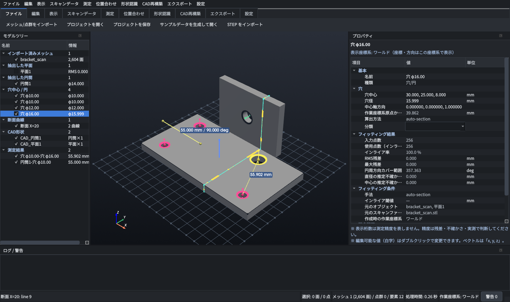

# LJM Reverse Engineering

Revopoint POP 4（Revo Scan 6）でスキャンした自動車部品のメッシュ／点群（STL・OBJ・PLY）から、
**形状認識・寸法測定・CAD 形状の再構築**を行い、Autodesk Fusion などで使える
**STEP / DXF / CSV** を出力する Windows 用リバースエンジニアリング支援ソフトです。



> **方針**: 複雑なメッシュを自動で完全なパラメトリックソリッドに変換することは前提にしていません。
> 「正確な形状認識（フィッティング）」と「ユーザーによる選択・修正」を組み合わせた**半自動方式**です。
> STL 全体を STEP 拡張子で保存するような偽の CAD 変換は行わず、STEP には実際に再構築した B-Rep のみを出力します。

## 主な機能（v0.2.0）

| 区分 | 機能 |
|---|---|
| 読込 | STL / OBJ / PLY（メッシュ・点群）、STEP（CAD）。日本語パス対応。単位の確認ダイアログ（mm/cm/m/inch） |
| 3D ビューア | 回転・パン・ズーム、6 方向 + アイソメ、シェーディング/エッジ/ワイヤー/点、透明、法線、グリッド・座標軸、平行投影、断面表示（クリッピング）、大規模メッシュの表示用 LOD |
| 選択 | 矩形選択（前面のみ可）、スマート選択（滑らかに連続する面）、ブラシ選択、拡大/縮小/反転 |
| 形状認識 | 平面（RANSAC + 最小二乗）、円筒（法線 RANSAC + 非線形最小二乗、部分円筒対応・不確かさ表示）、球、円（穴の縁）、穴中心（内壁∩基準平面 / 断面円 / 自動検出）、基準点・基準軸 |
| 測定 | 2点距離（成分付き）、3点角度、座標、点-平面、平面間（距離・角度・平行/直角）、軸間（距離・角度・同軸度）、穴中心間、点-軸、軸-平面、投影距離、バウンディングボックス、直径/半径、スケール確認・補正 |
| 座標系 | 3点、平面+軸、3平面（3-2-1）、軸+点、数値入力、作業座標系の切替、座標系をワールドに合わせる |
| 位置合わせ | 対応点（Kabsch）、ICP（点-面/点-点）、重複率・残差の評価 |
| メッシュ編集（非破壊） | 削除・トリミング・浮遊片除去・スムージング・簡略化・法線修正/反転・穴埋め（**人工面として区別**）・分割・分離・結合・オリジナル復元、点群の外れ値除去/法線推定/Poisson（Open3D 任意） |
| 断面・スケッチ | X/Y/Z・要素基準・軸を含む断面、連続断面、直線・円弧・円への自動分割、Bスプライン化 |
| CAD 再構築 (OCC) | 平面→面、円筒→円筒面/円柱、穴→円エッジ/円柱、球、軸→エッジ、閉じた断面の押し出し（穴付き）、回転体、ロフト、Bスプライン曲面フィット（制御点数指定）、ブーリアン、CAD-メッシュ偏差カラーマップ |
| 出力 | STEP（AP214/AP242, **再読込による形状・寸法検証付き**）、DXF（2D スケッチ要素 / 3D）、CSV（座標一覧・測定・距離マトリクス, Excel 対応 UTF-8 BOM）、JSON、STL/OBJ/PLY、独自プロジェクト `.ljmre` |
| 精度管理 | 使用点数・RMS/最大残差・インライア率・閾値・不確かさ(1σ)・円周カバー範囲・元ファイル・座標系を記録。表示桁数の設定。**安全上重要フラグと実測確認の記録**、未確認時の出力警告 |
| 自動車向け | 取付点一覧（サブフレーム等: 分類・座標・距離マトリクス CSV） |
| その他 | Undo/Redo、ワーカースレッド処理（進捗・キャンセル）、ログ、日本語 UI（ダークテーマ） |

実装状況・未実装機能の詳細は [docs/IMPLEMENTATION_STATUS.md](docs/IMPLEMENTATION_STATUS.md) を参照してください。

## 動作環境

- Windows 11 64bit（Linux でも動作確認済み）
- **Python 3.12（64-bit）**
- GPU: OpenGL 3.2 以上（RTX 3080 Ti 想定。GPU が無い環境でも計算は CPU で動作）
- 画面 1920×1080 以上推奨

## セットアップ（Windows）

1. [python.org](https://www.python.org/downloads/windows/) から **Python 3.12 (64-bit)** をインストール（「py ランチャー」を含める）
2. このフォルダで `setup_windows.bat` をダブルクリック（仮想環境 `.venv` を作成し、ライブラリをインストール）
   - Open3D（任意機能）も入れる場合: `setup_windows.bat --with-open3d`
   - テスト・EXE作成用: `setup_windows.bat --dev`
3. `run_ljm_re.bat` で起動（エラー調査時は `run_ljm_re_console.bat`）

手動の場合:

```bat
py -3.12 -m venv .venv
.venv\Scripts\python -m pip install -r requirements.txt
.venv\Scripts\python main.py
```

## サンプルデータとテスト

```bat
.venv\Scripts\python samples\generate_samples.py      :: 真値付きテストデータを samples\output に生成
.venv\Scripts\python samples\evaluate_accuracy.py     :: フィッティング精度の評価表
.venv\Scripts\python -m pytest -q                      :: 自動テスト（GUI テスト含む）
```

アプリ内の「ファイル > サンプルデータを生成して開く」でも同じテストモデルを読み込めます。

## EXE の作成

```bat
setup_windows.bat --dev
build_exe.bat
```

`dist\LJM_ReverseEngineering\LJM_ReverseEngineering.exe` が作成されます（onedir 形式。フォルダごと配布）。
同梱ライブラリのライセンスは [docs/LICENSES.md](docs/LICENSES.md) を参照してください。

## ドキュメント

- [操作説明（日本語）](docs/操作説明.md)
- [実装状況・テスト結果・残課題](docs/IMPLEMENTATION_STATUS.md)
- [設計判断・ライブラリ互換性調査](docs/DESIGN_DECISIONS.md)
- [ライセンス](docs/LICENSES.md)

## フォルダ構成

```
ljm-reverse-engineering/
├─ main.py                 起動スクリプト
├─ ljm_re/
│  ├─ core/                計算コア（GUI 非依存）: 幾何・フィッティング・測定・座標系・選択・断面・スケッチ・位置合わせ・メッシュ編集
│  ├─ cad/                 CAD バックエンド（OCP/OpenCASCADE）: B-Rep 生成・STEP 入出力・検証・再構築・偏差
│  ├─ model/               ドキュメント・オブジェクト・Undo/Redo・プロジェクト保存
│  ├─ io/                  メッシュ入出力・CSV・DXF
│  ├─ gui/                 PySide6 GUI（ビューア・ツリー・プロパティ・コマンド）
│  └─ utils/               設定・ログ・パス
├─ samples/                テストデータ生成・精度評価
├─ tests/                  pytest（コア + GUI）
├─ docs/                   ドキュメント
├─ requirements*.txt       依存関係（バージョン固定）
├─ *.bat                   Windows 用スクリプト
└─ ljm_re.spec             PyInstaller 設定
```

## 重要な注意

- スキャンデータから得た座標・寸法は**実測値ではありません**。サスペンション取付点など安全上重要な寸法は、
  必ずノギス・ハイトゲージ等で実測確認してください（プロパティの「安全上重要」「実測確認済み」で記録できます）。
- 表示桁数は表示上の丸めであり、測定精度を表しません。精度は RMS 残差・不確かさ・実測検証で判断してください。
- 位置合わせ（ICP）の残差が小さくても寸法精度が保証されるわけではありません。既知寸法でスケールを確認してください。
